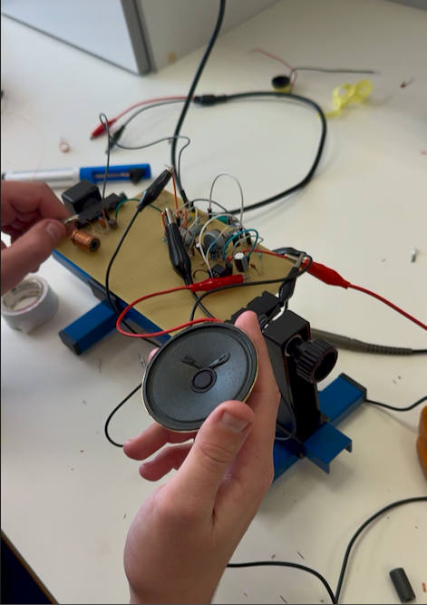
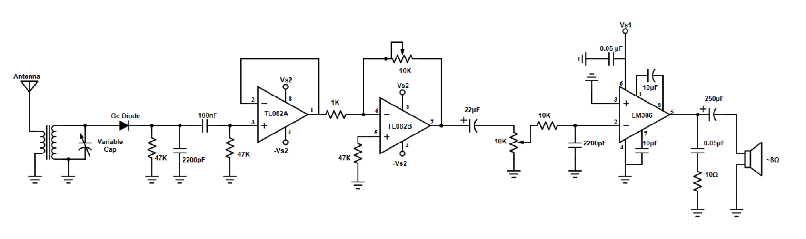
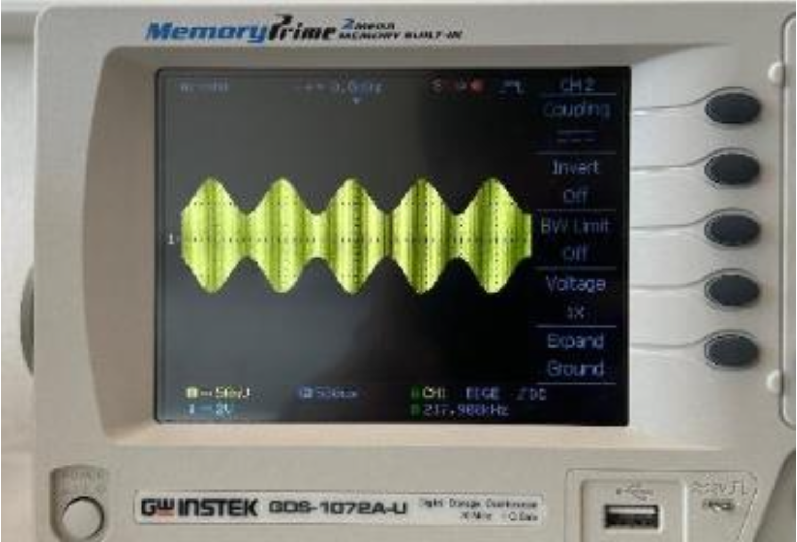
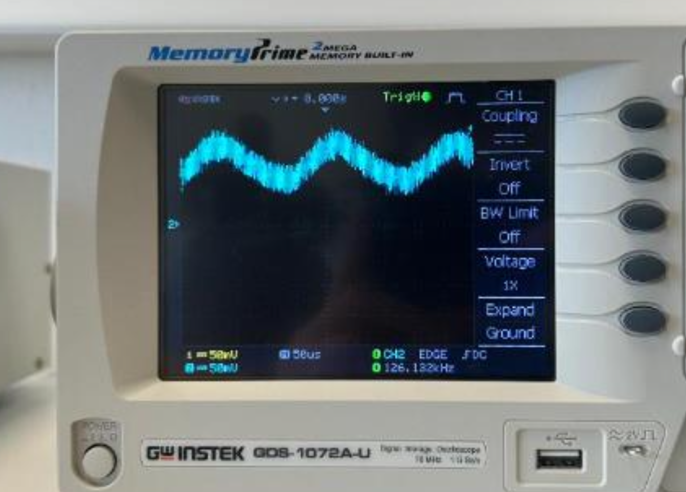

# AM Radio Receiver

A hand-built AM radio receiver that tunes to a radio signal, recovers the audio and plays it through a speaker. Built in a team of two at the Electronics Lab of the National Technical University of Athens (NTUA): we wound the coils by hand and soldered the final circuit on perfboard.

## What it does
The receiver picks up AM signals from the lab's antenna, selects one frequency with a tunable LC circuit, extracts the audio from the carrier and amplifies it to drive a speaker.

## Circuit

*Circuit based on the NTUA Electronics Lab design.*

## How it works

### 1. Tuning circuit
A hand-wound transformer couples the antenna signal into an LC tank formed by its secondary coil and a variable capacitor. The tank resonates at

f₀ = 1 / (2π√(LC))

so turning the variable capacitor selects which station is received.

### 2. Envelope detector
A germanium diode followed by 47 kΩ ∥ 2200 pF (τ = RC ≈ 103 µs) follows the carrier's peaks and recovers the audio envelope. A germanium diode was chosen for its low forward voltage (~0.3 V), suited to weak radio signals.
- **τ too small:** the capacitor discharges too fast between carrier peaks → large ripple, noisy output.
- **τ too large:** it discharges too slowly to follow the audio envelope → information is lost.

A 100 nF capacitor with a 47 kΩ resistor then removes the DC component of the detected signal.

| AM-modulated input | Demodulated output |
|---|---|
|  |  |

The fuzziness on the demodulated signal is residual carrier ripple, which the RC filter cannot fully remove. Later stages, including the 7.2 kHz low-pass filter before the LM386, reduce it further.

### 3. Buffer and preamplifier (TL082)
- **TL082A** is a voltage follower (gain 1). Its high input impedance prevents the next stages from loading the detector.
- **TL082B** is an inverting amplifier with gain −R_f / 1 kΩ. A 10 kΩ potentiometer in the feedback path makes the gain adjustable from 0 to 10.

### 4. Volume control and filtering
A 22 µF capacitor couples the signal to a 10 kΩ volume potentiometer. A 10 kΩ / 2200 pF low-pass filter (fc ≈ 7.2 kHz) then removes leftover RF and high-frequency noise.

### 5. Power amplifier (LM386)
The LM386 drives the speaker. The 10 µF capacitor between pins 1 and 8 sets its gain to 200. At the output, a Zobel network (0.05 µF + 10 Ω) keeps the amplifier stable, and a 250 µF capacitor blocks DC from the 8 Ω speaker.

## Development process
1. Each stage was first built and tested separately on a breadboard, using a function generator to produce a known AM signal (1 MHz carrier, 5 kHz tone, 80% modulation) and an oscilloscope to verify every stage.
2. The stages were simulated in LTspice. Since LTspice has no built-in LM386 model, we added it manually from the manufacturer's model files.
3. We wound the transformer coils by hand.
4. We soldered the complete receiver on perfboard and tested it with real signals from the lab's antenna.

## Components
- Hand-wound transformer, variable capacitor (tuning)
- Germanium diode, 47 kΩ resistors, 2200 pF and 100 nF capacitors (detector)
- TL082 dual op-amp, 1 kΩ and 47 kΩ resistors, 10 kΩ potentiometer (buffer and preamplifier)
- 10 kΩ potentiometer, 10 kΩ resistor, 2200 pF and 22 µF capacitors (volume and filtering)
- LM386 audio amplifier, 10 µF, 0.05 µF and 250 µF capacitors, 10 Ω resistor (power stage)
- 8 Ω speaker, perfboard

## What I learned
- How a radio receiver selects one station using LC resonance
- How AM demodulation works, and how the RC time constant trades off ripple against information loss
- Why buffering, gain staging and filtering matter between circuit stages
- Why a dedicated power amplifier is needed to drive a low-impedance load like a speaker
- Moving from breadboard prototypes to a hand-soldered, working circuit
- Comparing theory, simulation (LTspice) and real measurements

## Team
Built together with Konstantinos Raptis ([@kostas-raptis](https://github.com/kostas-raptis)) as part of the NTUA Electronics Lab course.
